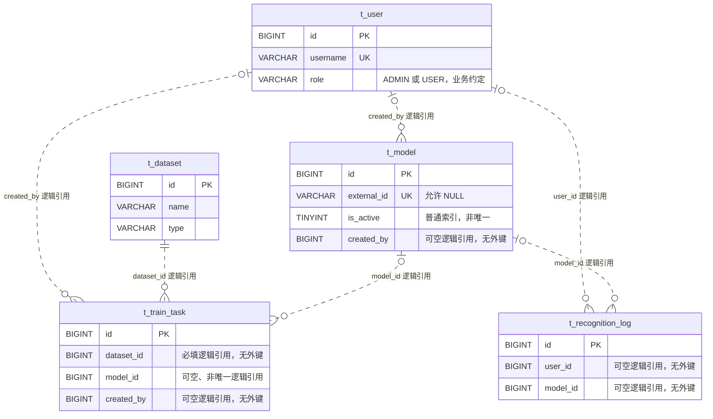

# 04 数据库设计

> 2026-11-12 更新：当前实现已到 V15，实际在用的表与「模型注册表不在库里」的说明见第 7–9 节；第 4 节为 W1 初期设计，保留作演进记录。

> W1 本地交付稿，供组员对照代码与联调；团队验收、MySQL 实际落库均待完成。本文不代表已评审或已验收。
>
> 结构依据：[`backend/src/main/resources/db/schema.sql`](../backend/src/main/resources/db/schema.sql)。五张表已在 schema 中定义，但 W1 Java 业务仅实现用户认证；其余表是后续功能的结构预留，不表示对应 CRUD、训练或识别业务已经实现。

## 1. 范围与统一约定

- 数据库：MySQL 8.0；五表均为 InnoDB、`utf8mb4`，主键均为自增 `BIGINT id`。
- 当前 schema 未显式指定排序规则，用户名是否区分大小写取决于实际数据库排序规则；不要假定其为大小写敏感。
- `CREATE TABLE IF NOT EXISTS` 可以重复执行，但**不会迁移或修复已有表的字段、索引差异**。
- 当前没有 `FOREIGN KEY`、`CHECK` 或数据库枚举约束。跨表 ID 是逻辑引用，存在性、状态范围与关联一致性需业务校验；本文的逻辑关系不等于数据库已强制保证。
- `t_user`、`t_model`、`t_dataset`、`t_train_task` 有 `deleted`，约定 `0` 未删除、`1` 已删除；`t_recognition_log` 没有逻辑删除字段。
- 当前只有 `User` 实体通过 `@TableLogic` 接入逻辑删除；其他三表仅有预留字段，不能据此声称已接入查询过滤。
- 字典中的“可空”对应 DDL 是否允许 `NULL`；“无”表示没有显式默认值。`CURRENT_TIMESTAMP / 更新时刷新` 对应 `ON UPDATE CURRENT_TIMESTAMP`。

## 2. 角色设计：固定 ADMIN / USER

权限直接使用 `t_user.role`，固定业务角色为 `ADMIN`（管理员）、`USER`（普通用户）。**不新增角色表、权限表或用户角色关联表，不扩展 RBAC 系统。** 数据库字段是 `VARCHAR(16)`，默认 `USER`，并没有 `CHECK` 限制取值。

| 入口 / 规则 | 当前行为 |
| --- | --- |
| `POST /api/auth/register` | 公开接口；服务强制写入 `role=USER`、`status=1`，请求 DTO 不提供角色赋值能力 |
| 管理员初始化 | `DataInitializer` 在用户名 `admin` 不存在时创建 `ADMIN` 用户 |
| `POST /api/auth/login` | 用真实 BCrypt 校验密码；不存在或密码错误为业务 `400`；停用账号为业务 `403` |
| JWT | 由服务签名，subject 为用户 ID，携带 username、role 与有效期；不保存密码或密码哈希 |
| `GET /api/auth/me` | 拦截器校验 JWT 后，按当前用户 ID 查询用户并返回 `UserVO` |
| `@RequireAdmin` | 支持方法和控制器类注解；仅 JWT 中 `role=ADMIN` 放行，否则业务 `403`；本次通过测试控制器验证，不新增管理端 CRUD |

接口保持现有统一契约：上述成功与可处理错误均为 **HTTP 200**，通过响应体 `code` 判断结果（成功为 `0`，参数错误/重复注册为 `400`，认证无效为 `401`，权限不足为 `403`，当前用户不存在为 `404`）。不要把这些业务码等同于 HTTP 状态码。

JWT 的角色来自登录时的快照。当前拦截器不逐次查库同步角色或停用状态，也没有 token 撤销系统；不要将账号修改描述成已签发 token 立即失效。W1 不扩展这些后续功能。

## 3. ER 图：仅表示逻辑关系

下图使用虚线标示逻辑引用；**schema 没有任何 DDL 外键**。图中基数表达业务关联意图，数据库仍允许写入不存在的关联 ID。可空引用对应零或一个逻辑对象；`dataset_id` 必填不等于其目标数据集一定存在。



文字对照：一个用户可关联多条模型、训练任务、识别日志；一个数据集可被多个训练任务引用；一个模型可被多条识别日志以及多个训练任务的 `model_id` 引用。**`t_train_task.model_id` 无唯一索引，不能宣称训练任务与模型一对一已约束。** 图中只列关键字段，完整定义见下节。

## 4. 五表字段字典

### 4.1 `t_user`：用户与认证

| 字段 | 类型 | 可空 | 默认 / 自动行为 | 含义与边界 |
| --- | --- | --- | --- | --- |
| `id` | BIGINT | 否 | AUTO_INCREMENT | 主键，JWT subject 对应此 ID |
| `username` | VARCHAR(64) | 否 | 无 | 用户名；唯一索引 `uk_username` |
| `password` | VARCHAR(100) | 否 | 无 | BCrypt 哈希，禁止保存明文或对外返回 |
| `nickname` | VARCHAR(64) | 是 | NULL | 昵称；注册时未填或纯空白则使用用户名 |
| `role` | VARCHAR(16) | 否 | `'USER'` | 业务限定 ADMIN / USER，无数据库枚举约束 |
| `status` | TINYINT | 否 | 1 | 业务约定 1 启用 / 0 停用；无 CHECK |
| `created_at` | DATETIME | 否 | CURRENT_TIMESTAMP | 创建时间 |
| `updated_at` | DATETIME | 否 | CURRENT_TIMESTAMP / 更新时刷新 | 更新时间 |
| `deleted` | TINYINT | 否 | 0 | 逻辑删除标记 |

索引：主键 `PRIMARY(id)`；唯一索引 `uk_username(username)`。

接口校验与存储长度不同：注册用户名为 **3–32 字符**，原始密码为 **6–32 字符**，昵称最长 **64 字符**；用户名、密码还须非空白。登录当前只对用户名、密码做非空白校验。数据库 `password` 的 100 字符容量用于存储哈希，不是密码输入上限。对外使用 `UserVO`，不直接序列化 `User` 实体。

唯一性以数据库为最终防线：服务先查重，插入时捕获 `DuplicateKeyException`，统一转换成业务 `400 / 用户名已存在`，覆盖两个注册请求同时通过预检查的情况。`uk_username` 不包含 `deleted`，逻辑删除的用户名仍占用唯一键；当前没有“删除后可复用用户名”的设计。

### 4.2 `t_model`：模型元数据

| 字段 | 类型 | 可空 | 默认 / 自动行为 | 含义与边界 |
| --- | --- | --- | --- | --- |
| `id` | BIGINT | 否 | AUTO_INCREMENT | 主键 |
| `name` | VARCHAR(64) | 否 | 无 | 模型名称 |
| `version` | VARCHAR(64) | 是 | NULL | 版本标识 |
| `external_id` | VARCHAR(64) | 是 | NULL | 外部模型服务标识 |
| `file_path` | VARCHAR(255) | 是 | NULL | 模型文件路径，不存模型二进制 |
| `accuracy` | DOUBLE | 是 | NULL | 准确率；范围未在 DDL 中约束 |
| `is_active` | TINYINT | 否 | 0 | 业务约定 0 未启用 / 1 已启用 |
| `description` | VARCHAR(255) | 是 | NULL | 描述 |
| `created_by` | BIGINT | 是 | NULL | 逻辑引用 `t_user.id`，无外键 |
| `created_at` | DATETIME | 否 | CURRENT_TIMESTAMP | 创建时间 |
| `updated_at` | DATETIME | 否 | CURRENT_TIMESTAMP / 更新时刷新 | 更新时间 |
| `deleted` | TINYINT | 否 | 0 | 逻辑删除预留字段 |

索引：`PRIMARY(id)`；`uk_external_id(external_id)` 唯一索引；`idx_active(is_active)` 普通索引。

注意：MySQL 唯一索引允许多个 `NULL external_id`；非 NULL 标识受唯一键限制，逻辑删除后仍占用。**`idx_active` 不是唯一索引，数据库没有“最多一个活跃模型”的约束**；如后续有此要求，需要单独设计事务与并发控制，W1 不实现。

### 4.3 `t_dataset`：数据集元数据

| 字段 | 类型 | 可空 | 默认 / 自动行为 | 含义与边界 |
| --- | --- | --- | --- | --- |
| `id` | BIGINT | 否 | AUTO_INCREMENT | 主键 |
| `name` | VARCHAR(64) | 否 | 无 | 数据集名称，当前没有名称唯一键 |
| `type` | VARCHAR(16) | 否 | `'MNIST'` | 类型默认值，不是已插入 MNIST 数据的证明 |
| `sample_count` | INT | 否 | 0 | 样本数量；无非负 CHECK |
| `storage_path` | VARCHAR(255) | 是 | NULL | 数据集存储路径 |
| `description` | VARCHAR(255) | 是 | NULL | 描述 |
| `created_at` | DATETIME | 否 | CURRENT_TIMESTAMP | 创建时间 |
| `updated_at` | DATETIME | 否 | CURRENT_TIMESTAMP / 更新时刷新 | 更新时间 |
| `deleted` | TINYINT | 否 | 0 | 逻辑删除预留字段 |

索引：只有 `PRIMARY(id)`，没有其他二级或唯一索引。

### 4.4 `t_train_task`：训练任务元数据

| 字段 | 类型 | 可空 | 默认 / 自动行为 | 含义与边界 |
| --- | --- | --- | --- | --- |
| `id` | BIGINT | 否 | AUTO_INCREMENT | 主键 |
| `name` | VARCHAR(64) | 否 | 无 | 任务名称 |
| `dataset_id` | BIGINT | 否 | 无 | 逻辑引用 `t_dataset.id`，无外键 |
| `model_name` | VARCHAR(64) | 否 | 无 | 训练使用的模型名称参数，不是模型外键 |
| `params_json` | TEXT | 是 | NULL | JSON 文本；类型是 TEXT，不由 MySQL JSON 类型校验 |
| `status` | VARCHAR(16) | 否 | `'PENDING'` | 任务状态；后续状态流转未在 W1 实现，DDL 不限制取值 |
| `progress` | INT | 否 | 0 | 进度；百分比含义及 0–100 范围需业务保证，DDL 无范围约束 |
| `external_task_id` | VARCHAR(64) | 是 | NULL | 外部训练服务任务标识；无唯一键 |
| `model_id` | BIGINT | 是 | NULL | 结果模型的逻辑引用 `t_model.id`；可暂未产生，无唯一键/外键 |
| `error_msg` | VARCHAR(500) | 是 | NULL | 错误信息 |
| `created_by` | BIGINT | 是 | NULL | 逻辑引用 `t_user.id`，无外键 |
| `created_at` | DATETIME | 否 | CURRENT_TIMESTAMP | 创建时间 |
| `updated_at` | DATETIME | 否 | CURRENT_TIMESTAMP / 更新时刷新 | 更新时间 |
| `deleted` | TINYINT | 否 | 0 | 逻辑删除预留字段 |

索引：`PRIMARY(id)`；普通索引 `idx_dataset_id(dataset_id)`、`idx_status(status)`。当前没有 `model_id`、`created_by`、`external_task_id` 索引，不要将未来可能需要的索引记为已实现。

### 4.5 `t_recognition_log`：识别记录

| 字段 | 类型 | 可空 | 默认 / 自动行为 | 含义与边界 |
| --- | --- | --- | --- | --- |
| `id` | BIGINT | 否 | AUTO_INCREMENT | 主键 |
| `user_id` | BIGINT | 是 | NULL | 逻辑引用 `t_user.id`，无外键 |
| `model_id` | BIGINT | 是 | NULL | 逻辑引用 `t_model.id`，无外键 |
| `result` | VARCHAR(64) | 是 | NULL | 识别结果，当前不是数字枚举或数值字段 |
| `confidence` | DOUBLE | 是 | NULL | 置信度；范围未由数据库约束 |
| `cost_ms` | INT | 是 | NULL | 耗时，单位毫秒；无非负 CHECK |
| `image_path` | VARCHAR(255) | 是 | NULL | 输入图像路径，不存图像二进制 |
| `created_at` | DATETIME | 否 | CURRENT_TIMESTAMP | 记录时间 |

索引：`PRIMARY(id)`；普通索引 `idx_created_at(created_at)`、`idx_model_id(model_id)`、`idx_user_id(user_id)`。本表**没有 `updated_at` 或 `deleted`**；当前未实现日志清理业务，也无级联删除。

## 5. 启动初始化与环境边界

配置依据：[`application.yml`](../backend/src/main/resources/application.yml)；初始化逻辑依据：[`DataInitializer.java`](../backend/src/main/java/com/hdr/config/DataInitializer.java)。

1. Spring SQL 初始化配置为 `mode: always`，启动时执行 `classpath:db/schema.sql`。默认连接本机 MySQL 的 `hdr` 库，连接地址包含 `createDatabaseIfNotExist=true`；实际建库/建表仍取决于连接成功与账号权限。可通过 `DB_URL`、`DB_USERNAME`、`DB_PASSWORD` 覆盖，禁止拿生产库做 W1 初始化验证。
2. `DataInitializer.run()` **只调用 `initAdmin()`**。它按用户名 `admin` 检查用户；不存在时插入 `admin / admin123`，密码存 BCrypt 哈希，昵称“管理员”，角色 `ADMIN`，状态 `1`；存在则直接跳过，不重置密码或修改角色。
3. **初始化器不创建 MNIST 数据集，不下载样本，不导入模型，不插入训练任务或识别记录。** `t_dataset.type` 的默认值 `MNIST` 只在插入且未指定类型时生效。
4. 默认管理员凭据仅供本地初始化使用，真实部署前必须通过安全流程更换；当前 W1 未新增修改密码接口。默认 JWT 密钥同样仅供开发，部署时应配置独立的 `JWT_SECRET`。
5. “重复启动”不等于已具备多实例并发初始化保障。管理员创建仍是查重后插入；注册接口中的唯一键冲突转换不代表初始化器已经实现并发重试。
6. 数据库默认时间与 Java 内存对象回填不是同一件事：注册响应未重新查库，`createdAt` 不保证立即回填；应以实际落库后查询为准。

## 6. W1 本地测试与待验清单

### 已增加的自动化覆盖（不连接数据库）

- [`UserServiceTest`](../backend/src/test/java/com/hdr/service/UserServiceTest.java)：真实 BCrypt、真实签发/解析 JWT，仅 mock `UserMapper`；覆盖正确/错误登录、停用账号、普通用户注册、昵称回退、响应不含密码/哈希、重复注册与 `DuplicateKeyException` 竞态、当前用户存在/不存在。
- [`AuthControllerTest`](../backend/src/test/java/com/hdr/controller/AuthControllerTest.java)：standalone MockMvc，接真实 `AuthController`、`UserService`、validator、全局 advice 和 `AuthInterceptor`；覆盖 HTTP 200 + 业务码契约、字段边界、非法请求体、登录后携带 token 查询 me、无效/过期/错误签名 JWT、非法 subject/claim 类型、方法及类管理员注解、成功/拒绝/异常后的上下文清理。
- 保留原有 `JwtUtilTest`。测试控制器仅在测试源码中，不新增生产管理接口。测试资源使用 `mock-maker-subclass`，避免依赖 Mockito inline 的 JVM 动态附加；密码编码器和 JWT 工具不 mock。

测试使用指定 Java 17 与 Maven。Git Bash 本地命令如下（`settings.xml` 仅在实际存在时添加）：

```bash
export JAVA_HOME='D:/Temp/hdr-w1-jdk-runtime/jdk-17.0.2'
export PATH="/d/Temp/hdr-w1-jdk-runtime/jdk-17.0.2/bin:$PATH"
MAVEN='/d/Temp/hdr-tools/apache-maven-3.9.9/bin/mvn'
SETTINGS=()
if test -f 'D:/Temp/hdr-tools/settings.xml'; then
  SETTINGS=(-s 'D:/Temp/hdr-tools/settings.xml')
fi
"$MAVEN" "${SETTINGS[@]}" -f backend/pom.xml test
"$MAVEN" "${SETTINGS[@]}" -f backend/pom.xml verify
```

本次先因旧 JDK 缺少 `lib/security/default.policy` 出现 1 个初始化错误。随后核对本机已有 JDK 压缩包与旧运行时的 `java.exe`、`lib/modules` 哈希一致，将完整发行包解压至独立目录，不关闭日志或安全机制。使用完整 JDK 正常执行离线 `mvn -o -B verify`：**61 例全部通过，0 failures、0 errors、0 skipped，BUILD SUCCESS**（JWT 1 例、服务层 15 例、HTTP 45 例）。日志位于 `backend/target/w1-verify-complete-jdk.log`。

已用本地只读脚本对照 schema 校验本文五表共 52 个字段的名称、类型及可空性，结果一致；这只是静态对照，不是 MySQL 落库验证。

### 自动化验证与待团队内部验收

- [x] 使用完整 JDK 执行 `verify`（包含测试与打包），61 例全通过，已保留实际日志。
- [ ] 在隔离的本地 MySQL 8.0 空库启动，检查五表的 `SHOW CREATE TABLE`、`SHOW INDEX` 是否与 schema 一致。
- [ ] 确认首次启动只有管理员种子数据，重复启动不重复插入；确认未自动创建 MNIST 数据集。
- [ ] 真实注册落库后检查 BCrypt 哈希、USER 角色、默认时间与自增 ID；确认登录和 me 响应没有密码或哈希。
- [ ] 使用两个独立数据库连接并发注册同一用户名，确认唯一键只允许一条记录、另一请求返回业务 400；mock 抛异常测试不替代真实并发验证。
- [ ] 检查数据库排序规则下用户名大小写、逻辑删除用户名仍占唯一键的实际行为。
- [ ] 团队在会前内部完成需求确认与验收；周四会议用于展示本周成果。本稿不填写未发生的评审或验收结论。

**尚未验证 MySQL 实际落库、MyBatis SQL/逻辑删除过滤、DDL 执行、启动初始化与真实并发。** standalone MockMvc 不启动完整 Spring Boot 应用，也不验证 MySQL/Redis、真实网络服务、CORS 或部署环境。

---

## 7. V2 业务表与外部权威（2026-11-12 补）

> 第 4 节是 W1 的初期设计（五张表），实现到 V15 后实际在用的是下面的表。
> 本节描述**现状**，第 4 节保留作演进记录。

### 7.1 当前表清单

| 类别 | 表 | 行数（示例库） |
|---|---|---|
| 身份与空间 | `t_user`、`t_auth_session`、`t_workspace`、`t_workspace_member` | 14 / 83 / 18 / 21 |
| 限流 | `t_rate_window` | 10 |
| 模型与训练 | `t_v2_model`、`t_v2_dataset`、`t_v2_training_task`、`t_v2_training_metric` | 18 / 0 / 17 / 29 |
| 识别与采集 | `t_recognition_v2`、`t_collected_sample` | 335 / 43 |
| 迁移历史 | `flyway_schema_history` | 15 |

W1 遗留且已不再写入的表：

| 表 | 说明 |
|---|---|
| `t_model` | 模型元数据（W1 遗留，空表） |
| `t_dataset` | 数据集元数据（W1 遗留，空表） |
| `t_train_task` | 训练任务（W1 遗留，空表） |
| `t_recognition_log` | 识别日志（W1 遗留，空表） |

### 7.2 **外部权威：模型注册表 `registry.json`（不在数据库里）**

| 问题 | 答案 |
|---|---|
| 在哪 | `model-service/weights/registry.json`，与权重文件同目录 |
| 管什么 | **哪些模型文件可信**：`modelId`、`version`、`preprocessVersion`、`artifact`、`sha256`、`sizeBytes` |
| 谁在用 | 模型服务启动/热重载时逐个文件算摘要校验；Java 注册与激活时也会比对 |
| 与数据库的关系 | **职责分离**：`t_v2_model` 决定“哪个模型生效”，`registry.json` 决定“哪些文件可信”；两边不一致时拒绝激活（`MODEL_DIGEST_MISMATCH`） |

**为什么不建表**

1. 模型服务（Flask）不连数据库，这是架构隔离：它只碰文件与内存；
2. 摘要校验必须与文件同源——注册表放在 `weights/` 旁边，文件丢了或改了立刻能发现；
3. 热重载只需重读文件（`POST /internal/v2/models/reload`），不需要 DB 事务；
4. 运维换权重、回滚版本可以直接编辑文件，不必连库。

**代价（已知）**

- 注册表的变更没有审计记录；
- 备份必须**两份一起**：MySQL + `weights/` 目录（含 `registry.json`），漏一份就无法完整恢复；
- 如果将来要多机部署，需要考虑把它同步到共享存储或引入数据库镜像（见 7.4）。

### 7.3 备份与恢复

| 对象 | 内容 | 频率建议 |
|---|---|---|
| MySQL | 全部业务表（含识别记录与采集样本元数据） | 每日 |
| `weights/` | 权重文件 + `registry.json` | 每次模型变更 |
| `collected-samples/` | 采集样本原图（按摘要去重） | 每日 |
| `recognition-images/` | 识别原图（V14 起保存） | 每日 |

恢复顺序：MySQL → `weights/` → 采集/识别图片目录。**注册表与权重必须成对恢复**，否则摘要校验失败、所有模型不可用。

### 7.4 已知取舍与后续选项

| 选项 | 做法 | 何时考虑 |
|---|---|---|
| 保持文件（当前） | 文件为运行依据，文档说明职责 | 单机部署 |
| 双写审计 | 保留文件，注册/更新时把快照写一行审计表 | 有合规或追责要求 |
| 迁入数据库 | 建 `t_model_registry`，模型服务通过内部接口读取 | 多机部署、需要统一备份点 |

当前选择：**保持文件 + 补文档**。运行依据仍以 `registry.json` 为准。

## 8. 关键表字段字典（按 V15 实际结构生成）

字段字典由 `information_schema` 直接导出，与迁移脚本保持一致；`空` 列表示是否允许 NULL，`键` 列中 PK/UNI/IDX 分别为主键、唯一键、普通索引。

### 8.1 `t_workspace`：工作空间

| 字段 | 类型 | 空 | 键 | 默认 | 额外 |
|---|---|---|---|---|---|
| `id` | bigint | NO | PK | — | auto_increment |
| `owner_id` | bigint | NO | IDX | — | — |
| `name` | varchar(64) | NO |  | — | — |
| `status` | varchar(16) | NO |  | ACTIVE | — |
| `personal_user_id` | bigint | YES | UNI | — | — |
| `default_model_id` | bigint | NO | IDX | — | — |
| `created_at` | datetime | NO |  | CURRENT_TIMESTAMP | DEFAULT_GENERATED |

### 8.2 `t_workspace_member`：空间成员与角色

| 字段 | 类型 | 空 | 键 | 默认 | 额外 |
|---|---|---|---|---|---|
| `workspace_id` | bigint | NO | PK | — | — |
| `user_id` | bigint | NO | PK | — | — |
| `role` | varchar(16) | NO |  | — | — |
| `status` | varchar(16) | NO |  | ACTIVE | — |
| `created_at` | datetime | NO |  | CURRENT_TIMESTAMP | DEFAULT_GENERATED |

### 8.3 `t_auth_session`：登录会话（令牌撤销）

| 字段 | 类型 | 空 | 键 | 默认 | 额外 |
|---|---|---|---|---|---|
| `id` | char(36) | NO | PK | — | — |
| `user_id` | bigint | NO | IDX | — | — |
| `expires_at` | datetime | NO | IDX | — | — |
| `revoked` | tinyint(1) | NO |  | 0 | — |
| `created_at` | datetime | NO |  | CURRENT_TIMESTAMP | DEFAULT_GENERATED |

### 8.4 `t_rate_window`：限流窗口计数

| 字段 | 类型 | 空 | 键 | 默认 | 额外 |
|---|---|---|---|---|---|
| `bucket_key` | char(64) | NO | PK | — | — |
| `window_start` | bigint | NO | PK | — | — |
| `hits` | bigint | NO |  | 0 | — |
| `expires_at` | bigint | NO | IDX | — | — |

### 8.5 `t_v2_model`：模型目录（生效与来源）

| 字段 | 类型 | 空 | 键 | 默认 | 额外 |
|---|---|---|---|---|---|
| `id` | bigint | NO | PK | — | auto_increment |
| `name` | varchar(64) | NO |  | — | — |
| `version` | varchar(64) | NO |  | — | — |
| `scope` | varchar(16) | NO | IDX | — | — |
| `workspace_id` | bigint | YES | IDX | — | — |
| `external_id` | varchar(64) | NO | IDX | — | — |
| `accuracy` | double | YES |  | — | — |
| `accuracy_dataset` | varchar(64) | YES |  | — | — |
| `preprocess_version` | varchar(64) | NO |  | — | — |
| `description` | varchar(255) | YES |  | — | — |
| `status` | varchar(16) | NO |  | ACTIVE | — |
| `created_at` | datetime | NO |  | CURRENT_TIMESTAMP | DEFAULT_GENERATED |
| `sha256` | char(64) | YES |  | — | — |
| `size_bytes` | bigint | YES |  | — | — |
| `artifact` | varchar(128) | YES |  | — | — |
| `origin` | varchar(16) | NO |  | IMPORTED | — |
| `task_id` | bigint | YES |  | — | — |
| `init_from` | varchar(64) | YES |  | — | — |
| `trained_at` | datetime | YES |  | — | — |
| `active_marker` | tinyint | YES |  | — | STORED GENERATED |
| `public_key` | varchar(160) | YES | UNI | — | STORED GENERATED |

### 8.6 `t_v2_dataset`：训练数据集元数据

| 字段 | 类型 | 空 | 键 | 默认 | 额外 |
|---|---|---|---|---|---|
| `id` | bigint | NO | PK | — | auto_increment |
| `name` | varchar(64) | NO |  | — | — |
| `version` | varchar(64) | NO |  | — | — |
| `scope` | varchar(16) | NO |  | — | — |
| `workspace_id` | bigint | YES | IDX | — | — |
| `train_samples` | int | NO |  | — | — |
| `test_samples` | int | NO |  | — | — |
| `description` | varchar(255) | YES |  | — | — |
| `status` | varchar(16) | NO |  | ACTIVE | — |
| `created_at` | datetime | NO |  | CURRENT_TIMESTAMP | DEFAULT_GENERATED |

### 8.7 `t_v2_training_task`：训练任务与队列状态

| 字段 | 类型 | 空 | 键 | 默认 | 额外 |
|---|---|---|---|---|---|
| `id` | bigint | NO | PK | — | auto_increment |
| `creator_id` | bigint | NO | IDX | — | — |
| `dataset_id` | bigint | NO | IDX | — | — |
| `target_model_id` | bigint | NO | IDX | — | — |
| `status` | varchar(16) | NO | IDX | — | — |
| `attempt` | int | NO |  | 0 | — |
| `epochs` | int | NO |  | — | — |
| `batch_size` | int | NO |  | — | — |
| `learning_rate` | double | NO |  | — | — |
| `seed` | bigint | NO |  | — | — |
| `photo_ratio` | decimal(3,2) | NO |  | — | — |
| `use_emnist` | tinyint | NO |  | 0 | — |
| `init_from` | varchar(64) | YES |  | — | — |
| `samples` | int | NO |  | — | — |
| `celery_task_id` | varchar(64) | YES | UNI | — | — |
| `model_version` | varchar(64) | YES |  | — | — |
| `artifact` | varchar(191) | YES |  | — | — |
| `sha256` | char(64) | YES |  | — | — |
| `size_bytes` | bigint | YES |  | — | — |
| `metrics` | json | YES |  | — | — |
| `error_category` | varchar(32) | YES |  | — | — |
| `error_message` | varchar(255) | YES |  | — | — |
| `queued_at` | datetime | NO |  | CURRENT_TIMESTAMP | DEFAULT_GENERATED |
| `started_at` | datetime | YES |  | — | — |
| `finished_at` | datetime | YES |  | — | — |
| `updated_at` | datetime | NO |  | CURRENT_TIMESTAMP | DEFAULT_GENERATED on update CURRENT_TIMESTAMP |

### 8.8 `t_v2_training_metric`：训练逐轮指标

| 字段 | 类型 | 空 | 键 | 默认 | 额外 |
|---|---|---|---|---|---|
| `id` | bigint | NO | PK | — | auto_increment |
| `task_id` | bigint | NO | IDX | — | — |
| `attempt` | int | NO |  | — | — |
| `epoch` | int | NO |  | — | — |
| `loss` | double | YES |  | — | — |
| `raw_mnist` | double | YES |  | — | — |
| `canvas_simulated` | double | YES |  | — | — |
| `photo_simulated` | double | YES |  | — | — |
| `recorded_at` | datetime | NO |  | CURRENT_TIMESTAMP | DEFAULT_GENERATED |

### 8.9 `t_recognition_v2`：识别记录（单字与多位数）

| 字段 | 类型 | 空 | 键 | 默认 | 额外 |
|---|---|---|---|---|---|
| `id` | bigint | NO | PK | — | auto_increment |
| `workspace_id` | bigint | NO | IDX | — | — |
| `creator_id` | bigint | NO | IDX | — | — |
| `request_id` | char(36) | NO |  | — | — |
| `image_digest` | char(64) | NO |  | — | — |
| `image_path` | varchar(255) | YES |  | — | — |
| `image_type` | varchar(32) | YES |  | — | — |
| `source` | varchar(16) | NO |  | — | — |
| `model_id` | bigint | NO | IDX | — | — |
| `model_version` | varchar(64) | NO |  | — | — |
| `preprocess_version` | varchar(64) | NO |  | — | — |
| `status` | varchar(16) | NO |  | PROCESSING | — |
| `digit` | tinyint | YES |  | — | — |
| `result_text` | varchar(8) | YES |  | — | — |
| `digits_json` | json | YES |  | — | — |
| `accepted` | tinyint(1) | NO |  | 0 | — |
| `confidence` | double | YES |  | — | — |
| `processing_ms` | bigint | YES |  | — | — |
| `failure_code` | varchar(32) | YES |  | — | — |
| `created_at` | timestamp(3) | NO |  | CURRENT_TIMESTAMP(3) | DEFAULT_GENERATED |
| `updated_at` | timestamp(3) | NO |  | CURRENT_TIMESTAMP(3) | DEFAULT_GENERATED on update CURRENT_TIMESTAMP(3) |

### 8.10 `t_collected_sample`：用户标注采集样本

| 字段 | 类型 | 空 | 键 | 默认 | 额外 |
|---|---|---|---|---|---|
| `id` | bigint | NO | PK | — | auto_increment |
| `workspace_id` | bigint | NO | IDX | — | — |
| `creator_id` | bigint | NO | IDX | — | — |
| `recognition_id` | bigint | YES |  | — | — |
| `label` | tinyint | YES |  | — | — |
| `sample_kind` | varchar(8) | NO |  | SINGLE | — |
| `label_text` | varchar(8) | YES |  | — | — |
| `predicted_digit` | tinyint | YES |  | — | — |
| `predicted_text` | varchar(8) | YES |  | — | — |
| `digit_count` | tinyint | YES |  | — | — |
| `confidence` | double | YES |  | — | — |
| `model_version` | varchar(64) | YES |  | — | — |
| `source` | varchar(16) | NO |  | WEB | — |
| `image_digest` | char(64) | NO |  | — | — |
| `artifact_path` | varchar(255) | NO |  | — | — |
| `size_bytes` | int | NO |  | — | — |
| `content_type` | varchar(32) | NO |  | — | — |
| `consent` | tinyint(1) | NO |  | 0 | — |
| `created_at` | timestamp(3) | NO |  | CURRENT_TIMESTAMP(3) | DEFAULT_GENERATED |


## 9. 迁移历史

| 版本 | 说明 |
|---|---|
| V1 | w1 baseline |
| V2 | identity workspaces public assets |
| V3 | recognition and limits |
| V4 | switch trusted baseline |
| V5 | switch photo baseline |
| V6 | model registry |
| V7 | training tasks |
| V8 | training finetune |
| V9 | recognition failure code |
| V10 | collected samples |
| V11 | multi digit results |
| V12 | multi digit samples |
| V13 | collected sample nullable label |
| V14 | recognition images |
| V15 | model provenance |

每一条迁移都有对应的 Flyway 版本号；结构与本文档不一致时，以 `backend/src/main/resources/db/migration/` 为准。

