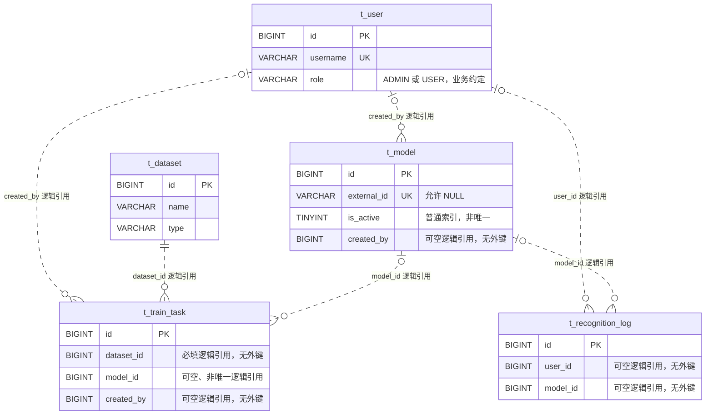

# 04 数据库设计

> W1 本地交付稿，供组员对照代码与联调；团队验收、MySQL 实际落库均待完成。本文不代表已评审或已验收。
>
> 结构依据：[`backend/src/main/resources/db/schema.sql`](../backend/src/main/resources/db/schema.sql)。五张表已在 schema 中定义，但 W1 Java 业务仅实现用户认证；其余表是后续功能的结构预留，不表示对应 CRUD、训练或识别业务已经实现。

## 1. 范围与统一约定

- 数据库：MySQL 8.0；五表均为 InnoDB、`utf8mb4`，主键均为自增 `BIGINT id`。
- 当前 schema 未显式指定排序规则，用户名是否区分大小写取决于实际数据库排序规则；不要假定其为大小写敏感。
- `CREATE TABLE IF NOT EXISTS` 可以重复执行，但**不会迁移或修复已有表的字段、索引差异**。
- 当前没有 `FOREIGN KEY`、`CHECK` 或数据库枚举约束。跨表 ID 是逻辑引用，存在性、状态范围与关联一致性需业务校验；本文的逻辑关系不等于数据库已强制保证。
- `t_user`、`t_model`、`t_dataset`、`t_train_task` 有 `deleted`，约定 `0` 未删除、`1` 已删除；`t_recognition_log` 没有逻辑删除字段。
- 当前只有 `User` 实体通过 `@TableLogic` 接入逻辑删除；其他三表仅有预留字段，不能据此声称已接入查询过滤。
- 字典中的“可空”对应 DDL 是否允许 `NULL`；“无”表示没有显式默认值。`CURRENT_TIMESTAMP / 更新时刷新` 对应 `ON UPDATE CURRENT_TIMESTAMP`。

## 2. 角色设计：固定 ADMIN / USER

权限直接使用 `t_user.role`，固定业务角色为 `ADMIN`（管理员）、`USER`（普通用户）。**不新增角色表、权限表或用户角色关联表，不扩展 RBAC 系统。** 数据库字段是 `VARCHAR(16)`，默认 `USER`，并没有 `CHECK` 限制取值。

| 入口 / 规则 | 当前行为 |
| --- | --- |
| `POST /api/auth/register` | 公开接口；服务强制写入 `role=USER`、`status=1`，请求 DTO 不提供角色赋值能力 |
| 管理员初始化 | `DataInitializer` 在用户名 `admin` 不存在时创建 `ADMIN` 用户 |
| `POST /api/auth/login` | 用真实 BCrypt 校验密码；不存在或密码错误为业务 `400`；停用账号为业务 `403` |
| JWT | 由服务签名，subject 为用户 ID，携带 username、role 与有效期；不保存密码或密码哈希 |
| `GET /api/auth/me` | 拦截器校验 JWT 后，按当前用户 ID 查询用户并返回 `UserVO` |
| `@RequireAdmin` | 支持方法和控制器类注解；仅 JWT 中 `role=ADMIN` 放行，否则业务 `403`；本次通过测试控制器验证，不新增管理端 CRUD |

接口保持现有统一契约：上述成功与可处理错误均为 **HTTP 200**，通过响应体 `code` 判断结果（成功为 `0`，参数错误/重复注册为 `400`，认证无效为 `401`，权限不足为 `403`，当前用户不存在为 `404`）。不要把这些业务码等同于 HTTP 状态码。

JWT 的角色来自登录时的快照。当前拦截器不逐次查库同步角色或停用状态，也没有 token 撤销系统；不要将账号修改描述成已签发 token 立即失效。W1 不扩展这些后续功能。

## 3. ER 图：仅表示逻辑关系

下图使用虚线标示逻辑引用；**schema 没有任何 DDL 外键**。图中基数表达业务关联意图，数据库仍允许写入不存在的关联 ID。可空引用对应零或一个逻辑对象；`dataset_id` 必填不等于其目标数据集一定存在。



文字对照：一个用户可关联多条模型、训练任务、识别日志；一个数据集可被多个训练任务引用；一个模型可被多条识别日志以及多个训练任务的 `model_id` 引用。**`t_train_task.model_id` 无唯一索引，不能宣称训练任务与模型一对一已约束。** 图中只列关键字段，完整定义见下节。

## 4. 五表字段字典

### 4.1 `t_user`：用户与认证

| 字段 | 类型 | 可空 | 默认 / 自动行为 | 含义与边界 |
| --- | --- | --- | --- | --- |
| `id` | BIGINT | 否 | AUTO_INCREMENT | 主键，JWT subject 对应此 ID |
| `username` | VARCHAR(64) | 否 | 无 | 用户名；唯一索引 `uk_username` |
| `password` | VARCHAR(100) | 否 | 无 | BCrypt 哈希，禁止保存明文或对外返回 |
| `nickname` | VARCHAR(64) | 是 | NULL | 昵称；注册时未填或纯空白则使用用户名 |
| `role` | VARCHAR(16) | 否 | `'USER'` | 业务限定 ADMIN / USER，无数据库枚举约束 |
| `status` | TINYINT | 否 | 1 | 业务约定 1 启用 / 0 停用；无 CHECK |
| `created_at` | DATETIME | 否 | CURRENT_TIMESTAMP | 创建时间 |
| `updated_at` | DATETIME | 否 | CURRENT_TIMESTAMP / 更新时刷新 | 更新时间 |
| `deleted` | TINYINT | 否 | 0 | 逻辑删除标记 |

索引：主键 `PRIMARY(id)`；唯一索引 `uk_username(username)`。

接口校验与存储长度不同：注册用户名为 **3–32 字符**，原始密码为 **6–32 字符**，昵称最长 **64 字符**；用户名、密码还须非空白。登录当前只对用户名、密码做非空白校验。数据库 `password` 的 100 字符容量用于存储哈希，不是密码输入上限。对外使用 `UserVO`，不直接序列化 `User` 实体。

唯一性以数据库为最终防线：服务先查重，插入时捕获 `DuplicateKeyException`，统一转换成业务 `400 / 用户名已存在`，覆盖两个注册请求同时通过预检查的情况。`uk_username` 不包含 `deleted`，逻辑删除的用户名仍占用唯一键；当前没有“删除后可复用用户名”的设计。

### 4.2 `t_model`：模型元数据

| 字段 | 类型 | 可空 | 默认 / 自动行为 | 含义与边界 |
| --- | --- | --- | --- | --- |
| `id` | BIGINT | 否 | AUTO_INCREMENT | 主键 |
| `name` | VARCHAR(64) | 否 | 无 | 模型名称 |
| `version` | VARCHAR(64) | 是 | NULL | 版本标识 |
| `external_id` | VARCHAR(64) | 是 | NULL | 外部模型服务标识 |
| `file_path` | VARCHAR(255) | 是 | NULL | 模型文件路径，不存模型二进制 |
| `accuracy` | DOUBLE | 是 | NULL | 准确率；范围未在 DDL 中约束 |
| `is_active` | TINYINT | 否 | 0 | 业务约定 0 未启用 / 1 已启用 |
| `description` | VARCHAR(255) | 是 | NULL | 描述 |
| `created_by` | BIGINT | 是 | NULL | 逻辑引用 `t_user.id`，无外键 |
| `created_at` | DATETIME | 否 | CURRENT_TIMESTAMP | 创建时间 |
| `updated_at` | DATETIME | 否 | CURRENT_TIMESTAMP / 更新时刷新 | 更新时间 |
| `deleted` | TINYINT | 否 | 0 | 逻辑删除预留字段 |

索引：`PRIMARY(id)`；`uk_external_id(external_id)` 唯一索引；`idx_active(is_active)` 普通索引。

注意：MySQL 唯一索引允许多个 `NULL external_id`；非 NULL 标识受唯一键限制，逻辑删除后仍占用。**`idx_active` 不是唯一索引，数据库没有“最多一个活跃模型”的约束**；如后续有此要求，需要单独设计事务与并发控制，W1 不实现。

### 4.3 `t_dataset`：数据集元数据

| 字段 | 类型 | 可空 | 默认 / 自动行为 | 含义与边界 |
| --- | --- | --- | --- | --- |
| `id` | BIGINT | 否 | AUTO_INCREMENT | 主键 |
| `name` | VARCHAR(64) | 否 | 无 | 数据集名称，当前没有名称唯一键 |
| `type` | VARCHAR(16) | 否 | `'MNIST'` | 类型默认值，不是已插入 MNIST 数据的证明 |
| `sample_count` | INT | 否 | 0 | 样本数量；无非负 CHECK |
| `storage_path` | VARCHAR(255) | 是 | NULL | 数据集存储路径 |
| `description` | VARCHAR(255) | 是 | NULL | 描述 |
| `created_at` | DATETIME | 否 | CURRENT_TIMESTAMP | 创建时间 |
| `updated_at` | DATETIME | 否 | CURRENT_TIMESTAMP / 更新时刷新 | 更新时间 |
| `deleted` | TINYINT | 否 | 0 | 逻辑删除预留字段 |

索引：只有 `PRIMARY(id)`，没有其他二级或唯一索引。

### 4.4 `t_train_task`：训练任务元数据

| 字段 | 类型 | 可空 | 默认 / 自动行为 | 含义与边界 |
| --- | --- | --- | --- | --- |
| `id` | BIGINT | 否 | AUTO_INCREMENT | 主键 |
| `name` | VARCHAR(64) | 否 | 无 | 任务名称 |
| `dataset_id` | BIGINT | 否 | 无 | 逻辑引用 `t_dataset.id`，无外键 |
| `model_name` | VARCHAR(64) | 否 | 无 | 训练使用的模型名称参数，不是模型外键 |
| `params_json` | TEXT | 是 | NULL | JSON 文本；类型是 TEXT，不由 MySQL JSON 类型校验 |
| `status` | VARCHAR(16) | 否 | `'PENDING'` | 任务状态；后续状态流转未在 W1 实现，DDL 不限制取值 |
| `progress` | INT | 否 | 0 | 进度；百分比含义及 0–100 范围需业务保证，DDL 无范围约束 |
| `external_task_id` | VARCHAR(64) | 是 | NULL | 外部训练服务任务标识；无唯一键 |
| `model_id` | BIGINT | 是 | NULL | 结果模型的逻辑引用 `t_model.id`；可暂未产生，无唯一键/外键 |
| `error_msg` | VARCHAR(500) | 是 | NULL | 错误信息 |
| `created_by` | BIGINT | 是 | NULL | 逻辑引用 `t_user.id`，无外键 |
| `created_at` | DATETIME | 否 | CURRENT_TIMESTAMP | 创建时间 |
| `updated_at` | DATETIME | 否 | CURRENT_TIMESTAMP / 更新时刷新 | 更新时间 |
| `deleted` | TINYINT | 否 | 0 | 逻辑删除预留字段 |

索引：`PRIMARY(id)`；普通索引 `idx_dataset_id(dataset_id)`、`idx_status(status)`。当前没有 `model_id`、`created_by`、`external_task_id` 索引，不要将未来可能需要的索引记为已实现。

### 4.5 `t_recognition_log`：识别记录

| 字段 | 类型 | 可空 | 默认 / 自动行为 | 含义与边界 |
| --- | --- | --- | --- | --- |
| `id` | BIGINT | 否 | AUTO_INCREMENT | 主键 |
| `user_id` | BIGINT | 是 | NULL | 逻辑引用 `t_user.id`，无外键 |
| `model_id` | BIGINT | 是 | NULL | 逻辑引用 `t_model.id`，无外键 |
| `result` | VARCHAR(64) | 是 | NULL | 识别结果，当前不是数字枚举或数值字段 |
| `confidence` | DOUBLE | 是 | NULL | 置信度；范围未由数据库约束 |
| `cost_ms` | INT | 是 | NULL | 耗时，单位毫秒；无非负 CHECK |
| `image_path` | VARCHAR(255) | 是 | NULL | 输入图像路径，不存图像二进制 |
| `created_at` | DATETIME | 否 | CURRENT_TIMESTAMP | 记录时间 |

索引：`PRIMARY(id)`；普通索引 `idx_created_at(created_at)`、`idx_model_id(model_id)`、`idx_user_id(user_id)`。本表**没有 `updated_at` 或 `deleted`**；当前未实现日志清理业务，也无级联删除。

## 5. 启动初始化与环境边界

配置依据：[`application.yml`](../backend/src/main/resources/application.yml)；初始化逻辑依据：[`DataInitializer.java`](../backend/src/main/java/com/hdr/config/DataInitializer.java)。

1. Spring SQL 初始化配置为 `mode: always`，启动时执行 `classpath:db/schema.sql`。默认连接本机 MySQL 的 `hdr` 库，连接地址包含 `createDatabaseIfNotExist=true`；实际建库/建表仍取决于连接成功与账号权限。可通过 `DB_URL`、`DB_USERNAME`、`DB_PASSWORD` 覆盖，禁止拿生产库做 W1 初始化验证。
2. `DataInitializer.run()` **只调用 `initAdmin()`**。它按用户名 `admin` 检查用户；不存在时插入 `admin / admin123`，密码存 BCrypt 哈希，昵称“管理员”，角色 `ADMIN`，状态 `1`；存在则直接跳过，不重置密码或修改角色。
3. **初始化器不创建 MNIST 数据集，不下载样本，不导入模型，不插入训练任务或识别记录。** `t_dataset.type` 的默认值 `MNIST` 只在插入且未指定类型时生效。
4. 默认管理员凭据仅供本地初始化使用，真实部署前必须通过安全流程更换；当前 W1 未新增修改密码接口。默认 JWT 密钥同样仅供开发，部署时应配置独立的 `JWT_SECRET`。
5. “重复启动”不等于已具备多实例并发初始化保障。管理员创建仍是查重后插入；注册接口中的唯一键冲突转换不代表初始化器已经实现并发重试。
6. 数据库默认时间与 Java 内存对象回填不是同一件事：注册响应未重新查库，`createdAt` 不保证立即回填；应以实际落库后查询为准。

## 6. W1 本地测试与待验清单

### 已增加的自动化覆盖（不连接数据库）

- [`UserServiceTest`](../backend/src/test/java/com/hdr/service/UserServiceTest.java)：真实 BCrypt、真实签发/解析 JWT，仅 mock `UserMapper`；覆盖正确/错误登录、停用账号、普通用户注册、昵称回退、响应不含密码/哈希、重复注册与 `DuplicateKeyException` 竞态、当前用户存在/不存在。
- [`AuthControllerTest`](../backend/src/test/java/com/hdr/controller/AuthControllerTest.java)：standalone MockMvc，接真实 `AuthController`、`UserService`、validator、全局 advice 和 `AuthInterceptor`；覆盖 HTTP 200 + 业务码契约、字段边界、非法请求体、登录后携带 token 查询 me、无效/过期/错误签名 JWT、非法 subject/claim 类型、方法及类管理员注解、成功/拒绝/异常后的上下文清理。
- 保留原有 `JwtUtilTest`。测试控制器仅在测试源码中，不新增生产管理接口。测试资源使用 `mock-maker-subclass`，避免依赖 Mockito inline 的 JVM 动态附加；密码编码器和 JWT 工具不 mock。

测试使用指定 Java 17 与 Maven。Git Bash 本地命令如下（`settings.xml` 仅在实际存在时添加）：

```bash
export JAVA_HOME='D:/Temp/hdr-w1-jdk-runtime/jdk-17.0.2'
export PATH="/d/Temp/hdr-w1-jdk-runtime/jdk-17.0.2/bin:$PATH"
MAVEN='/d/Temp/hdr-tools/apache-maven-3.9.9/bin/mvn'
SETTINGS=()
if test -f 'D:/Temp/hdr-tools/settings.xml'; then
  SETTINGS=(-s 'D:/Temp/hdr-tools/settings.xml')
fi
"$MAVEN" "${SETTINGS[@]}" -f backend/pom.xml test
"$MAVEN" "${SETTINGS[@]}" -f backend/pom.xml verify
```

本次先因旧 JDK 缺少 `lib/security/default.policy` 出现 1 个初始化错误。随后核对本机已有 JDK 压缩包与旧运行时的 `java.exe`、`lib/modules` 哈希一致，将完整发行包解压至独立目录，不关闭日志或安全机制。使用完整 JDK 正常执行离线 `mvn -o -B verify`：**61 例全部通过，0 failures、0 errors、0 skipped，BUILD SUCCESS**（JWT 1 例、服务层 15 例、HTTP 45 例）。日志位于 `backend/target/w1-verify-complete-jdk.log`。

已用本地只读脚本对照 schema 校验本文五表共 52 个字段的名称、类型及可空性，结果一致；这只是静态对照，不是 MySQL 落库验证。

### 自动化验证与待团队内部验收

- [x] 使用完整 JDK 执行 `verify`（包含测试与打包），61 例全通过，已保留实际日志。
- [ ] 在隔离的本地 MySQL 8.0 空库启动，检查五表的 `SHOW CREATE TABLE`、`SHOW INDEX` 是否与 schema 一致。
- [ ] 确认首次启动只有管理员种子数据，重复启动不重复插入；确认未自动创建 MNIST 数据集。
- [ ] 真实注册落库后检查 BCrypt 哈希、USER 角色、默认时间与自增 ID；确认登录和 me 响应没有密码或哈希。
- [ ] 使用两个独立数据库连接并发注册同一用户名，确认唯一键只允许一条记录、另一请求返回业务 400；mock 抛异常测试不替代真实并发验证。
- [ ] 检查数据库排序规则下用户名大小写、逻辑删除用户名仍占唯一键的实际行为。
- [ ] 团队在会前内部完成需求确认与验收；周四会议用于展示本周成果。本稿不填写未发生的评审或验收结论。

**尚未验证 MySQL 实际落库、MyBatis SQL/逻辑删除过滤、DDL 执行、启动初始化与真实并发。** standalone MockMvc 不启动完整 Spring Boot 应用，也不验证 MySQL/Redis、真实网络服务、CORS 或部署环境。
